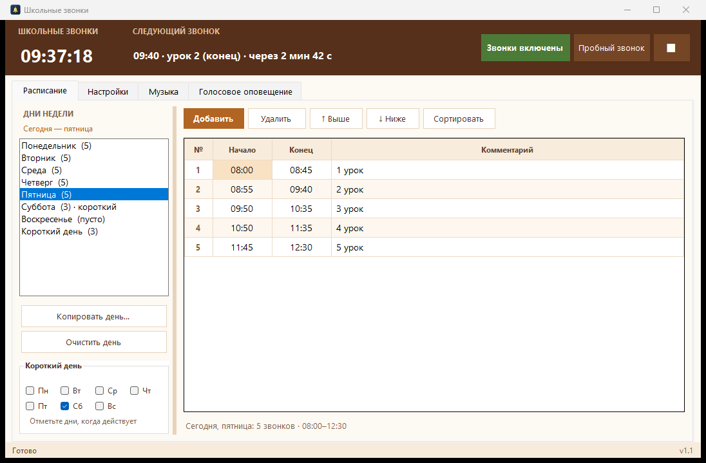
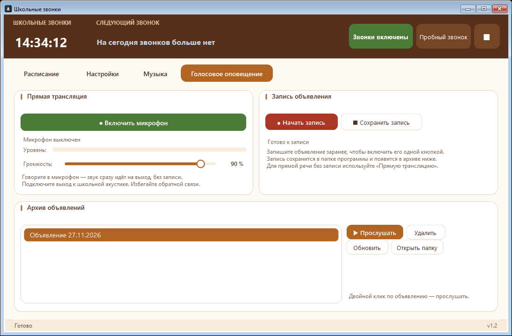

# Школьные звонки

[](https://github.com/IvanSemenovVetarion/SchoolBells)
[](https://dotnet.microsoft.com/)
[](LICENSE)
[](https://github.com/IvanSemenovVetarion/SchoolBells)

Лёгкая портативная программа автоматических школьных звонков для Windows 10 и Windows 11.
Работает без установки, не требует прав администратора и подходит для старого ноутбука.

> **Скачать:** [последний релиз](https://github.com/IvanSemenovVetarion/SchoolBells/releases/latest)



## Возможности

- Расписание звонков на каждый день недели.
- Отдельный шаблон **«Короткий день»** и отметка коротких дней.
- Гибкий ввод времени: `08:00`, `0800`, `800`, `8`, `8.30`, `930`, `1230`.
- Копирование расписания одного дня сразу в несколько дней.
- Своя MP3-мелодия для начала и конца урока.
- Несколько цветовых палитр и автоматическая смена темы по сезону.
- Зимняя тема с анимированными снежинками.
- **Музыка на всю школу** — по расписанию и вручную.
- **Голосовые объявления** — запись с микрофона и трансляция.
- Работа в области уведомлений (трее), автозапуск, журналы звонков и ошибок.
- Все данные хранятся рядом с программой в папке `SchoolBellsData`.

## Что нового в версии 1.1

- Добавлены сезонные темы: весна, лето, осень, зима, а также классическая, графит и тёплая.
- Зимняя тема украшена анимированными снежинками (можно отключить).
- Добавлен шаблон «Короткий день» и галочки для дней недели.
- Время можно вводить без двоеточия: `0800` автоматически превращается в `08:00`.
- Добавлена вкладка «Музыка»: расписание музыки и ручной плейлист.
- Добавлена вкладка «Голосовое оповещение»: запись, архив и прослушивание.
- В «О программе» добавлены автор и ссылка на GitHub.

## Скриншоты

| Расписание | Настройки |
| --- | --- |
|  |  |

| Музыка на всю школу | Голосовое оповещение |
| --- | --- |
|  |  |

| Зимняя тема со снежинками |
| --- |
|  |

## Скачать и запустить

1. Скачайте `SchoolBells.exe` из репозитория или готовый архив `SchoolBells-portable.zip`.
2. Положите файл в любую папку, доступную для записи, например `C:\SchoolBells`.
3. Запустите `SchoolBells.exe`.
4. Заполните расписание и нажмите «Пробный звонок».

Установка не требуется. При первом запуске рядом с программой создаётся папка `SchoolBellsData`.

## Короткий день

В списке дней недели есть восьмой пункт — **«Короткий день»**. Это отдельный шаблон расписания.
В блоке «Короткий день» отметьте дни недели, когда он должен действовать. Например, отметьте
субботу — и в этот день программа будет звонить по короткому расписанию, а в остальные дни
по обычному.

## Музыка на всю школу

Вкладка **«Музыка»** позволяет:

- добавлять музыку по расписанию (день, начало, конец, комментарий);
- выбирать «Каждый день» или конкретный день недели;
- добавлять файлы в ручной плейлист и включать их одной кнопкой;
- регулировать громкость музыки отдельно от звонков.

Музыка звучит через динамики компьютера или подключённую школьную акустику. Файлы копируются
в папку программы, поэтому оригиналы можно перемещать.

## Голосовое оповещение

Вкладка **«Голосовое оповещение»** записывает объявление с микрофона:

1. Нажмите «● Начать запись».
2. Произнесите объявление.
3. Нажмите «■ Остановить и сохранить».
4. Запись появится в архиве — её можно прослушать или удалить.

Записи сохраняются в формате WAV в `SchoolBellsData` и воспроизводятся через выбранный
звуковой выход. Для трансляции на школу подключите выход компьютера к школьной акустике.

## Темы оформления

Доступны темы:

- **Авто (по сезону)** — весна, лето, осень, зима;
- Классическая синяя;
- Весенняя зелень;
- Летнее небо;
- Осенняя охра;
- **Зима / Новый год** — со снежинками;
- Графит;
- Тёплая терракота.

Тема применяется сразу, перезапуск не нужен.

## Сборка из исходников

Требуется .NET Framework 4.x (входит в Windows 10/11) и встроенный `csc.exe`.

```bat
build.cmd
```

Скрипт соберёт `SchoolBells.exe` с иконкой, манифестом и версией. Внешние библиотеки
и установщики не нужны.

Проверка логики и звука:

```bat
test.cmd
test.cmd --no-audio
```

## Структура проекта

```text
src\        исходный код C# (WinForms)
tests\      самотесты
tools\      вспомогательные скрипты
docs\       скриншоты для документации
app.ico     иконка
app.manifest манифест совместимости и DPI
build.cmd   сборка
test.cmd    сборка и запуск самотестов
```

## Лицензия

Проект распространяется по лицензии [MIT](LICENSE).

Copyright © 2026 Иван Семёнов.

## Автор

**Иван Семёнов**  
GitHub: [@IvanSemenovVetarion](https://github.com/IvanSemenovVetarion)

Если программа оказалась полезной — поставьте звезду репозиторию.
